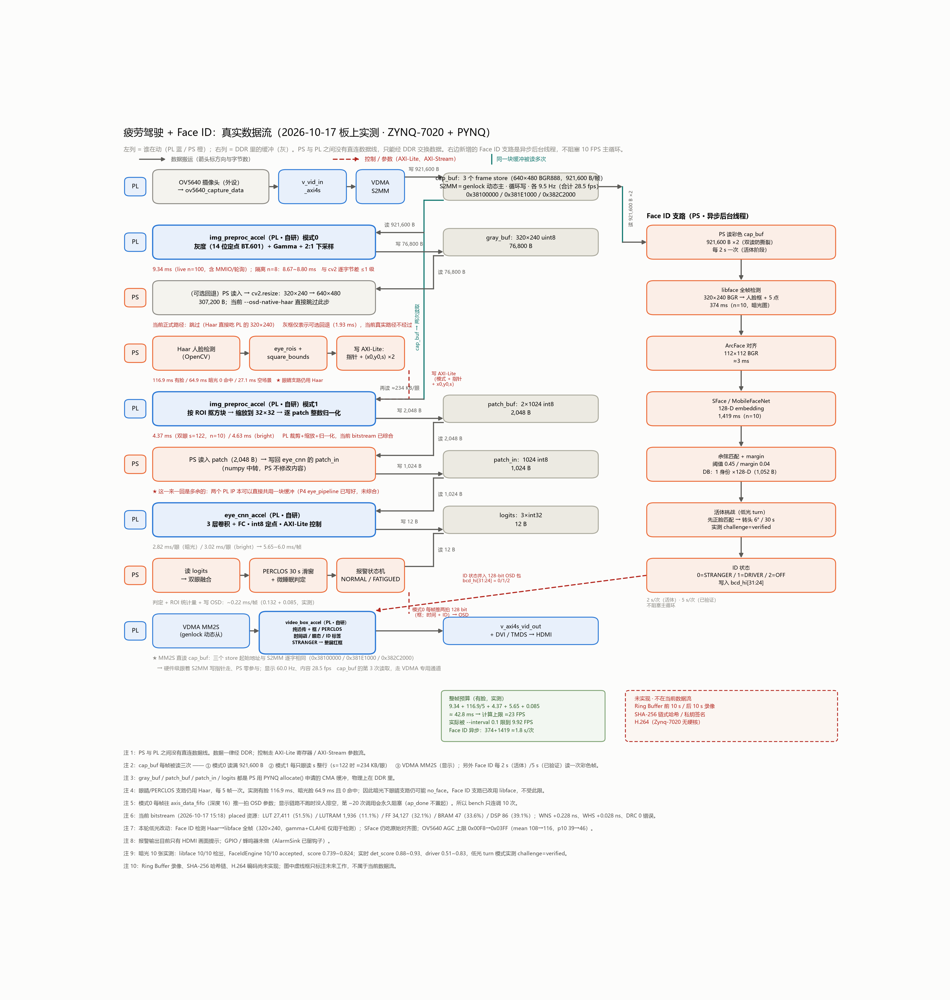

# 设计报告：基于 ZYNQ-7020 + PYNQ 的双 CNN 驾驶员状态监测（DMS）

> 2026 全国大学生嵌入式芯片与系统设计竞赛（AMD 自主选题赛道，初级组）
> 完整工程见仓库根目录；本报告的数字均来自 `build/reports/`、`board/` 与
> `report/reference/` 的实测记录。

---

## 1. 选题背景与创新点

### 1.1 背景

商用车 DMS 需要同时回答“人是否疲劳”“是否分心”“是否在抽烟/打电话”
“镜头是否被遮挡”“当前驾驶员是否有授权”。在 ZYNQ-7020 上做这件事有两个硬约束：

- **没有 DPU/Vitis AI 支持**（Vitis AI 只支持 UltraScale+ MPSoC 与 Versal），
  7020 上没有任何现成的 AI 推理框架；
- A9 双核 + 有限 PL 资源，**不能把帧率、面积、时序同时挥霍**。

因此本作品的核心不是“调一个模型”，而是：**在 7020 上自己搭一条
可验证、可复现、资源/时序可交代的 PL 加速链路**。

### 1.2 创新点

1. **两个自研 HLS CNN，而不是一个“大网络”**：
   - EyeNet-3C：32×32 眼态三分类（闭/睁/无效）；
   - ContextNet：48×48 人脸 ROI → 头姿 4 类 + 手持物 4 类（共享 backbone、双头）。
   这样已经验证过的眼态数据（CEW/MRL/板上数万条）全部继续可用，
   新网络独立降规格/独立回退。
2. **int8 定点契约与逐位验证**：权重/激活尺度全取 2 的幂，运行期只有
   整数乘加/算术右移/max/clip；PC `quant_ref.py` 金标准与 HLS C 仿真、
   板上硬件**逐位相同**（不是容差比对）。
3. **异步低频的 Face ID / 活体**：SFace 在 A9 上约 1.4~1.7 s，放进主循环会毁掉
   10 FPS；用后台 worker + 主循环取快照，身份/活体只做会话与低频复核。
4. **完整证据链**：PL OSD 时间戳、事件 pre/post 录像、SHA-256 哈希链、
   遥测/上位机；把“检测”做成可审计的事件，而不是一帧 demo。
5. **把误报当数据问题，而不是调阈值**：正脸手空段的 cigarette 误报在
   同一留出集上从 **76/76 降到 0/76**，同时报告代价（真烟召回 100%→93.9%）。
6. **通用 PYNQ Skill**：把 HLS 集成/逐位验证、VDMA 稳定采集/显示、
   Vivado 报告自动化沉淀成 3 个与题目无关的技能包（见 `skill/`）。

---

## 2. 设计原理与功能框图

### 2.1 实际数据流



```text
OV5640 → capture → v_vid_in_axi4s → VDMA S2MM → DDR（3 frame stores）
DDR → VDMA MM2S → v_axi4s_vid_out → VTC → DVI/TMDS → HDMI
                     ▲
                     │ video_box_accel（PL OSD：框/眼态/PERCLOS/时间/DRIVER）

PS：
  稳定读帧（双读防撕裂）→ Haar 人脸框（libface 异步补框）
    ├─ 眼睛 ROI → img_preproc 模式1（32×32 patch）→ eye_cnn_accel
    ├─ 人脸 ROI 48×48（PS 裁剪 K=2.0）→ context_cnn_accel
    ├─ 画面统计（Canny 边缘 + 亮度）→ 遮挡 covered/recovery
    ├─ 人脸丢失计时 → no_driver
    ├─ 异步 Face ID（libface 5 点 + SFace + 活体）
    └─ 眼态/头姿/物体 → 事件状态机 → 遥测/录像/哈希链/OSD
```

**PL/PS 边界**：两者没有直连数据线；像素经 DDR，控制走 AXI-Lite，
OSD 参数走 `img_preproc → video_box_accel`。

### 2.2 软硬件划分依据

| 功能 | 放在 | 理由 |
|---|---|---|
| 灰度/Gamma/2:1 缩放、眼睛 patch | PL `img_preproc` | 每帧全图，PS 做会吃满 A9 |
| 眼态 CNN | PL `eye_cnn_accel` | 2.4 ms/眼；PS 定点推理更慢 |
| 头姿/手持物 CNN | PL `context_cnn_accel` | 4.6 ms/次；与眼态共享 DDR/互联 |
| 人脸检测 | PS Haar | 级联复杂、A9 可接受（~100 ms/次，隔帧） |
| 上下文裁剪 | PS | 只裁一块 48×48，避免改已上板的 `img_preproc` |
| Face ID / 活体 | PS 异步 | SFace 1.4~1.7 s，不能进主循环 |
| OSD | PL `video_box_accel` | 保持 HDMI 60 fps，彩色帧不经 PS |
| 遥测/录像/哈希链 | PS | 网络/文件/时间逻辑，PL 不适合 |

### 2.3 接口与地址

| 接口 | 说明 |
|---|---|
| `axi_vdma_0` | S2MM：视频 → DDR；MM2S：DDR → HDMI |
| `eye_cnn_accel_0` | AXI-Lite `0x41700000`；`m_axi_gmem` → `axi_smc/S02_AXI` |
| `img_preproc_accel_0` | AXI-Lite `0x41800000`；`m_axi_gmem` → `S03_AXI`（64 位） |
| `context_cnn_accel_0` | AXI-Lite **`0x41A00000`**；`m_axi_gmem` → `S04_AXI`（32 位） |
| `axi_timer_0` | `0x41900000`，PL 时间基（时间戳 OSD） |
| `cam_iic` | `0x41600000`，OV5640 SCCB（AXI IIC） |

时序约束：`clk_fpga_0` 100 MHz（CNN/AXI），`cam_pclk` 72 MHz（13.888 ns），
`axi_dynclk_0_PXL_CLK_O` 25.12 MHz（VTC/HDMI）。

---

## 3. 优化过程（前后对比）

### 3.1 模式0 的 AXI 位宽 32 → 64

| | 32 位（原始） | 64 位（修复） |
|---|---:|---:|
| PL 模式0（preprocess） | 10.70 ms | **8.88 ms** |
| 4 次 A/B/A | 10.70 / 10.69（换回） | 8.89 / 8.88 |

根因：BD 实例上存了一个 `C_M_AXI_GMEM_DATA_WIDTH=32` 的参数覆盖，
IP 默认是 64；`upgrade_ip` 不会改参数覆盖。修复后逐字节等价性仍 PASS。

### 3.2 Haar 降本

| | 改前 | 改后 |
|---|---:|---:|
| 真实帧 Haar 中位 | 168.5 ms | **122.6 ms（−27%）** |
| 无脸场景整轮 `it_ms` | 138.8 ms | **13.45 ms（−90%）** |
| 检出率 / 框 | 基线 | **IoU 1.000、0 漏检** |

两处：`minSize` 以 `MIN_FACE_PX` 为单一真源；没人脸时也按 stride 重检，
不再每帧跑 Haar。

### 3.3 CNN 延迟与整链

| | EyeNet-3C | ContextNet |
|---|---:|---:|
| 参数 | 22,403 | 32,672 |
| MAC | 680,032 | 1,355,008 |
| csynth 延迟 | 2.329 ms | 4.560 ms |
| 板上延迟 | **2.42 ms/眼** | **4.73 ms/次** |
| 逐位验证 | C 仿真 8 用例 | C 仿真 4 用例 + 板上 20/20 |

整链：context 关 **9.9 FPS**；context 开 **7.4~7.8 FPS**（320 Haar 开销）。
7 FPS 的瓶颈不是 AI：CNN 只占整循环 142 ms 的约 3.5%。

### 3.4 加 ContextNet 前后的资源/时序

| 资源 | 加之前（2026-10-17） | 首次加 ContextNet（10-18） | **交付版（10-24 重出）** |
|---|---:|---:|---:|
| LUT | 27,411 (51.5%) | 35,236 (66.2%) | **38,134 (71.68%)** |
| FF | 34,127 (32.1%) | 41,438 (39.0%) | **41,458 (38.96%)** |
| BRAM | 47 tiles (33.6%) | 81.5 tiles (58.2%) | **81.5 tiles (58.21%)** |
| DSP | 86 (39.1%) | 140 (63.6%) | **140 (63.64%)** |
| WNS / WHS | +0.228 / +0.028 ns | +0.134 / +0.023 ns | **+0.186 / +0.026 ns** |

BRAM 比纸张估计高（原估 +6~8 RAMB36，实测 +34.5 tiles），原因是
48×48 的激活缓冲（`ca`/`xpad`）随输入面积增长；仍放得下，但**时序余量很薄**。
交付版比 10-18 版多约 2,900 LUT，是重新综合后的真实占用；**差异未逐项拆解**
（以 `build/reports/` 的 placed 报告为准）；WNS 反而略好（+0.134 → +0.186）。

---

## 4. 功能正确性

### 4.1 眼态 / PERCLOS

- 睁眼级联召回 **95~98%**（受控实验，戴/不戴眼镜 95/95 vs 98/98）；
- 闭眼三条守卫：双漏 + ROI 可信 + 近期命中；
- 标定与盲验证：正常段 **0 报警**，疲劳段 **6/6** 真闭眼段；
  正常段 PERCLOS 峰值 0.086（阈值 0.40）。
- 真实低光：Haar 0/10 → libface 补框 10/10；真实低光睁眼
  UNKNOWN 85%→38%、无人脸 55%→0%；暗光闭眼默认双眼规则仍受限（见 §8）。

### 4.2 ContextNet

**基线（10-18 模型，2 折按会话）**：头姿 macro-R **0.946 / 0.946**，
手持物 **0.666 / 0.751**；PTQ 头姿掉 0~1.4 点、手持物 ±0.7~1.6 点，
argmax 一致率 93.5%~100%；板上 20/20 随机 int8 输入逐位相同。
事件级回放（`eval_context_events.py`）：distraction 9/10、phone_call 9/10、
smoking **10/10**，`normal` 段 0 误报。

**误报抑制（10-24 重训，交付模型）**：真实驾驶姿势下，正脸、手空、戴眼镜的
正常段被大量判成 `cigarette`。根因是训练集缺“戴眼镜 · 手空 · 正脸”这类外观，
不是阈值太高。补采 N1/N2/N3（**N3 整段留出**）与 P1b 真动作留出后重训：

| 留出集 | 指标 | 旧模型（10-18） | **新模型（10-24）** |
|---|---|---:|---:|
| N3 摘眼镜正脸 76 帧（`label_object=none`） | 误报（margin ≥ 500） | 76/76 = 100% | **0/76 = 0%** |
| P1b 真烟 33 帧 | cigarette 召回（argmax） | 33/33 = 100% | **31/33 = 93.9%** |
| P1b 真烟 33 帧 | cigarette 召回（margin ≥ 500） | 33/33 = 100% | **29/33 = 87.9%** |
| P1b 真手机 33 帧 | phone 召回 | 0/33 | **0/33** |

- 同一组 5 会话**选模验证集**（非留出，新模型）：头姿 macro **0.9284**、手持物
  **0.6737**；float/quant argmax 一致率 **97.30% / 94.85%**；两个留出会话
  **142/142 = 100%**。
- **代价**：真烟召回 100% → 93.9%，头姿 macro 0.9457 → 0.9284。这是“压误报”的
  真实成本，不做隐藏。
- ★ **P1b 真手机 0/33 是已知弱点，不是本次回归**：手机贴左耳、深色机身，
  ROI 里只露一条黑边（`report/figures/p1b_phone_check.png`）。旧模型全判
  `cigarette`、新模型全判 `none`。演示与验收**不要用“手机贴耳”当 phone 判据**。
- **证据边界**：N3 / P1b 与训练数据**同人、同房间、同一天**；换人、换房间的
  误报率本轮**没有测**，不能外推。
- **板上实拍复核**（450 帧、`--context-stride 5`，共 **90 次**推理）：手持物全部
  `none`、头姿全部 `forward`、**cigarette 0 次**；平均 **8.50 FPS**。
  说明离线误报率降下来之后，真实摄像头 + OSD 主循环里也没有再报。

**补充对照（hardneg 按帧切半）**：训练集完全不含硬负样本时，留出的 33 帧误报
**33/33 = 100%**（margin ≥ 0；margin ≥ 500 时 30/33 = 90.9%）；前半 ×5 进训练后
降到 **1/33 = 3.0%**。说明模型**有能力**学会这类外观，但这 33 帧与训练帧同人
同场景，**仍不能证明跨人泛化**。

### 4.3 DMS 阶段 A（板上 80 项测试）

| 项 | 实测 |
|---|---|
| 遮挡 | `covered` 16 s（18.5→34.6 s），手移开 <2 s 恢复 |
| 离岗 | **20.0 s** 进入 `no_driver` |
| 录像 | `event_0001` 113 帧 / 11.44 s，MJPEG 解码 113 帧 OK |
| 哈希链 | 链完整，0 问题 |
| 活体 | 14 次挑战通过 5 / 未通过 9（操作者未盯提示属预期） |
| 时间戳 | OSD 左下角；`event.json` `t_wall=2026-10-17T23:25:54+08:00` |

### 4.4 验证方法

- **C 仿真逐位比对**（无容差）：`sim/README.md`；
- **PC 单测**：canonical 19 / context_logic 10 / collect 36 / collect_run 27 /
  telemetry 18 / face_id / dashboard 24；
- **板上**：`test_context_cnn_hw.py --hw` 20/20、Face ID 引擎、DMS 80 项；
- **防假 PASS**：用例 logits 不能全相同；反向对照必须失败；
  宽度/ROM/bit-hwh 都从生成物读回校验。

### 4.5 2026-10-23/24 增强

10-23 的四项增强**全部在 PS 侧，不改 PL、不重出 bitstream**；10-24 的 ContextNet
重训只替换 ROM 权重（无逻辑改动），但仍需重新综合/出 bitstream —— 交付版
WNS +0.186 ns。

| 增强 | 实现 | 验证状态 |
|---|---|---|
| HDMI 身份标签 | `video_box` 已有 5×7 字模；`face_id_state` 经 `TIME_BCD_HI[31:24]` 传 0/1/2 | 复用现有 PL；补了启动顺序 bug（`snapshots/` 未建导致 Face ID 静默失效）与“拿到首份结果前不闪 STRANGER” |
| 侧脸注册 | 正/左/右各约 30°，每人多模板；匹配按身份取 max；旧库兼容 | 板上重标：阈值 **0.45** 落在 genuine/impostor 间隔中间；侧脸 30° **132/132 accepted** |
| 软件报警 | 疲劳/陌生人/分心/抽烟/打电话/遮挡/离岗 → 合并状态机；OSD bit14 闪 + 终端 + 遥测/上位机 | PC：`test_alert_logic` 14 项；上位机 30 项；板上六类报警受控验收全触发 |
| 陌生人留证 | 可验证人脸且未授权才拍；30 s 限频；独立 SHA-256 链 | PC：`test_stranger_snapshot` 9 项；板上 400 帧转头：0 抓拍、0 ALERT |

**2026-10-24 可靠性修正（都是状态机/判据，不是算法）**：

| 问题 | 根因 | 修法与实测 |
|---|---|---|
| OSD 红绿反复闪 | 活体挑战是循环的（verified → wait_blink/wait_turn），而 demo 只要 state≠verified 就把身份设 STRANGER | 新增 `last_verified_id`：仅 verified 点亮，挑战期间保持上一份已确认身份；**明确失败或人脸丢失才降级**；单轮挑战失败/超时不作废 |
| `face lost` 误判 | `face-id-face-lost=1.5 s` 只比时间，而 `--face-stride=8` 在 ~7 FPS 下两次检测本身隔 1.2 s，Haar 偶发漏一次就越线 | 改为**时间超阈值 且 连续 ≥2 次检测无脸**；600 帧实测 0 次误闪；代价是真离开降级从 ~1.5 s 变约 2.5 s |
| 陌生人抓拍误拍 | `verifiable` 只要求 \|yaw\|<80°，SFace 在大侧脸分数不可靠 | 新增 `--face-id-stranger-max-yaw 45°`：超角保持上次身份、不报警、不抓拍；400 帧转头 0 抓拍 |
| ContextNet 误报 | 训练集缺“戴眼镜 · 手空 · 正脸”外观 | 硬负样本 N1/N2/N3 + P1b 留出重训；N3 误报 **76/76 → 0/76**（见 §4.2） |

**明确不做**：蜂鸣器（板载 BEEP 在 PL 引脚 M14，需重出 bitstream 且 WNS 仅
+0.186 ns）；HDMI 显示姓名/分数（需扩字库与改参数流）。

---

## 5. 大模型协作（摘要）

完整记录见 `report/llm_collaboration.md`，原始会话脱敏节选在
`report/llm_transcript/`。

工作流：**Plan → Explore → Implement → Test → Review → Fix**。

模型主要用于：

- 软硬件划分与量化契约设计；
- 从生成网表/报告定位问题（32 位 AXI 覆盖、IP 锁定、MM2S 启动顺序）；
- 写测试与金标准脚本；
- 对每个结论给出可执行的验证命令，再由实测确认/推翻。

典型的**自我纠错**（都写进了记录）：

- 曾把 SmartConnect 扩口后的 S03 期望位宽写成 32、把 S01 查成 rdata；
  读生成 `.hwh` 后纠正（S03 是 64、S01 只有 wdata）；
- 曾把 context 的 320×240 上采样图当输入，导致正脸误报；
  改为全分辨率读取后修正；
- 曾把 `--osd-native-haar` 的 `--face-detect-scale 2` 当 320 检测，
  实际是 160；定位后修正；
- 曾把“回读显示缓冲一致”当成“显示通路正常”，后来用满屏色块自检推翻；
- 曾把 `--train-all` 报告的“误报 0%”当作证据，后来发现它的监视集就是训练集的
  子集（train/val 都含 hardneg），改为**整段留出 N3** 才得到可信的
  76/76 → 0/76；
- 换 ContextNet 权重时只换了综合源码、漏了板上金标准，硬件逐位测试
  **20/20 全 FAIL**，一度像“硬件坏了”；补齐三处权重后 20/20 通过。

---

## 6. 技能包提炼

见 `report/skill_extraction.md` 与 `skill/`。3 个通用 Skill：

1. **PYNQ HLS 加速器集成与逐位验证**；
2. **PYNQ VDMA 稳定采集/显示**；
3. **Vivado 资源/时序/复现报告自动化**。

每项都写明适用场景、使用方法、已验证效果、失效条件，以及从哪些失败中总结。

---

## 7. 复现说明

```bash
# PC：C 仿真
cd src/hls && sh build_csim.sh all

# PC：PS 单测
cd ../ps && python tests/test_canonical.py

# 构建
cd ../hls && .\build_ip.bat context_cnn
cd ../vivado/project && vivado -mode batch -source ../build_bitstream.tcl

# 板端
cd ~/jupyter_notebooks/PYNQ/src
bash run.sh demo_eye_perclos.py --osd --classifier cnn --osd-native-haar \
  --face-detect-scale 2 --face-stride 8 --face-fallback \
  --context --context-stride 5 --osd-time --osd-tz-hours 8 --frames 0 --interval 0.1
```

工具：Vivado/Vitis 2026.1；板端 PYNQ 2.7 / Python 3.8；PC 训练 PyTorch CPU。
完整数据不随仓库分发（见 `data/README.md`）。

---

## 8. 局限与展望

- **单目能力边界**：无法可靠区分“抢方向盘”和“弯腰捡东西”，需要 CAN/方向盘转矩；
  本作品明确不做该功能。
- **真实低光闭眼**：默认双眼规则在真实低光下召回受限（单眼低对比度）；
  单眼规则会抬误报，只作非默认选项。彻底修法需补真实低光 open/closed 数据重训。
- **手持物头**：跨会话/侧向数据偏置；`other` 是 catch-all。当前用按类 margin
  （phone 500 / cigarette 600 / other 1500）+ 1.5 s hold + 1.2 s release；
  阈值来自两折验证集的事件级回放（`report/reference/context_margin_calibration.md`）。
  举水杯等 `other` 动作仍可能误报 `phone_call`，量产需补数据与阈值标定。
- **误报抑制的证据边界**：76/76 → 0/76（§4.2）是**同人、同房间、同一天**的
  留出会话；换人/换房间的误报率未测，不能外推。
- **手机贴耳 + 深色手机**：P1b 的 33 帧真手机，新旧模型都是 **0/33**（旧模型判
  `cigarette`、新模型判 `none`）。演示与验收不要用“手机贴耳”当成功判据；
  按“屏幕前举起手机”这个可复现姿态演示。彻底修法需补侧向/贴脸姿态数据。
- **Face ID**：阈值是小样本工程值，**不是商用 FAR/FRR/PAD 认证**；
  turn 模式弱于 blink_turn。活体挑战未完成时 OSD 仍显示 `STRANGER` —— 这是
  安全语义（只有 verified 才点亮），演示时需按提示做一次眨眼/转头，
  或关闭 `--face-id-liveness`。
- **RTC**：板载时钟不准，每次上电需校时；量产加 NTP/DS3231。
- **FPS**：context on 约 7.5 FPS；下一步可做 face ROI tracking（纯 PS）。
- **H.264 / 环形缓冲**：证据链用 MJPEG pre/post，未做 H.264；材料中不宣称。

---

## 附录：关键源文件

```text
src/hls/eye_cnn/             EyeNet-3C HLS
src/hls/context_cnn/         ContextNet HLS
src/hls/img_preproc/         灰度/Gamma/缩放 + 眼 patch
src/hls/video_box/           PL OSD（框/时间/DRIVER/红框）
src/ps/eye_cnn.py            眼 CNN 驱动
src/ps/context_cnn.py        ContextNet 驱动
src/ps/context_logic.py      事件状态机/margin 弃权
src/ps/demo_eye_perclos.py   主 demo（眼态/PERCLOS/context/录像/遥测）
src/ps/face_id.py            Face ID + 活体
src/ps/occlusion.py          遮挡/离岗
src/ps/recorder.py           事件录像
src/ps/integrity.py          SHA-256 哈希链
src/ml/                      训练/量化/导出
src/vivado/                  BD Tcl / 工程 / ip_repo
```
